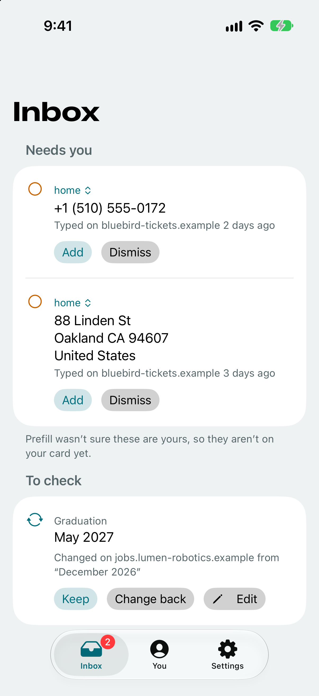
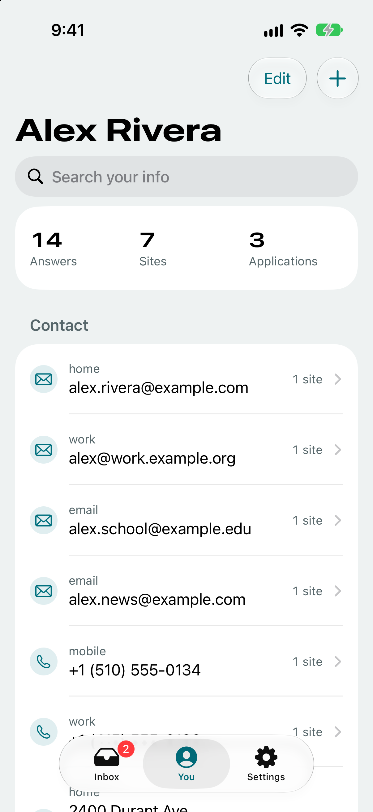
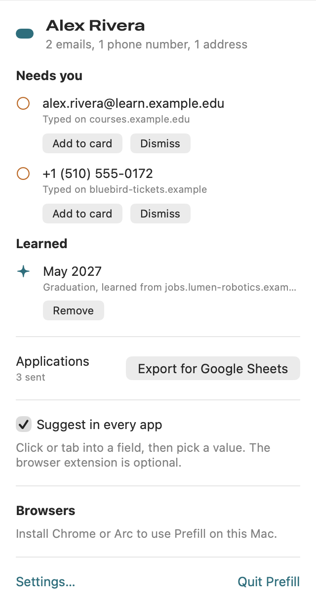
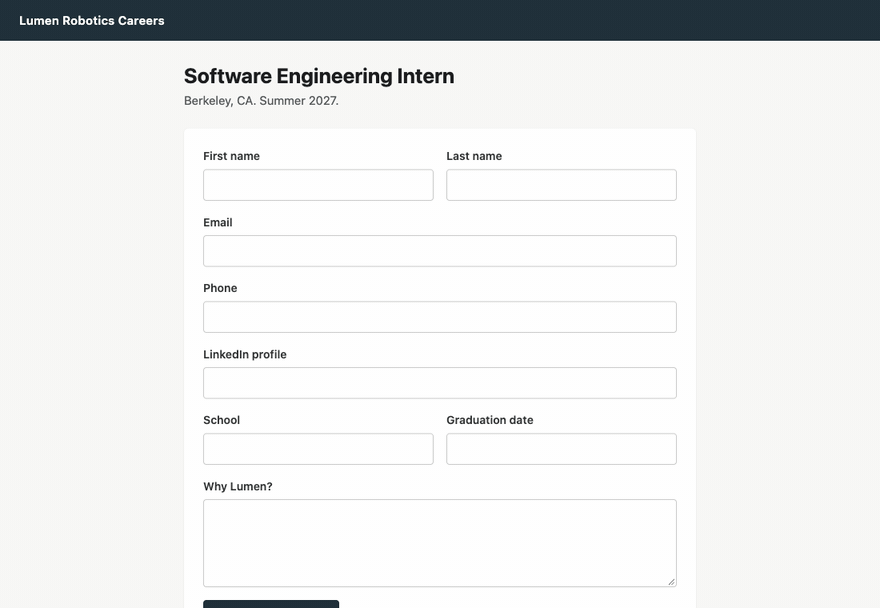

# Prefill

Your verified information, ready for the next application.

Prefill is for people who apply to a lot of things: jobs, fellowships, accelerators, events. It keeps your emails, phone numbers, addresses, profile links and the answers you've given before, and puts the right one in the field when you click it, or fills the whole form when you ask.

- **Browser extensions, where Prefill does its work:** Safari on the iPhone, and Chrome and Arc on the Mac. A Safari extension for the Mac isn't built yet; until it is, Safari on the Mac gets the Accessibility panel below. Click a field and Prefill's list shows your values, best first, each saying why it's there. What you pick comes first on that site next time. Fill form fills a whole application, declines demographic questions, and tells you which fields still need you.
- **iPhone app, to manage and review:** an Inbox of what Prefill learned and what needs a decision, and a searchable You tab with every answer and where it was used.
- **Fallbacks you use by hand, outside the browser:**
  - **Mac Accessibility panel:** suggests in other Mac apps once you allow Accessibility. It fills text fields only, doesn't save new values, and some apps don't expose their fields to it.
  - **iPhone keyboard:** the Prefill keyboard lets you tap a saved value in another app. A keyboard isn't told the field's label, so you choose the value yourself, and some apps block third-party keyboards (password and other secure fields always do).
- **Sync:** everything lives in iCloud Contacts, so the iPhone and Mac stay in step with no server and no paid developer account.

<p>
  
  
  
</p>



Read [docs/PRODUCT.md](docs/PRODUCT.md) for the full picture: what it was built to do, how it works, and how it was built. Read [AGENTS.md](AGENTS.md) before changing code.

## Install

These steps need Xcode 27, pnpm and xcodegen; `scripts/bootstrap.sh` checks for them.

**iPhone.** Plug the phone in, unlock it, then run:

```bash
zsh scripts/install-device.sh <device-udid>
```

On the iPhone:
1. Trust the developer profile in Settings → General → VPN & Device Management.
2. Open Prefill. Setup is two steps: choose your contact card, then turn on the extension in Safari (Allow Extension, and All Websites set to Allow). The second step's checks turn green on their own, the last one once Safari opens a page with a form.

A free Apple ID signs the app for 7 days only, so rerun the script weekly, or let the Mac do it.

### Weekly reinstall

```bash
zsh scripts/auto-reinstall.sh --force        # once, by hand: click Always Allow on keychain prompts
zsh scripts/install-auto-reinstall.sh        # then a launchd agent checks daily at 12:15
```

The agent reinstalls when the last install is 5.5 days old or its profile expires within 36 hours, and retries every 10 minutes for 3 hours while the phone is locked or away. It posts a notification either way. The log is in `~/Library/Logs/Prefill/auto-reinstall.log`. Leave the phone plugged in or on the same Wi-Fi, and keep the repo out of Desktop, Documents and iCloud Drive (launchd jobs can't read those). Pass a device ID to either script to target another phone; `--uninstall` removes the agent.

**Mac.**

```bash
zsh scripts/install-mac.sh
```

Then open the Prefill menu. Until each item is done it shows a checklist, and each item checks itself:
1. Allow Contacts.
2. Turn on Accessibility (System Settings → Privacy & Security → Accessibility). Open takes you there.
3. Add the browser extension: Copy folder path, then in `chrome://extensions` or `arc://extensions` turn on Developer mode, click Load unpacked, press Command-Shift-G and paste. The folder is `/Applications/Prefill.app/Contents/Resources/ChromeExtension`, and the `Chrome Extension` shortcut in the repo root points there. The item turns green once the extension talks to the app. Without it, Chrome and Arc get only the Accessibility panel, which fills text fields only. After each reinstall, click Reload on it in each browser.

## Develop

```bash
zsh scripts/build.sh
zsh scripts/test.sh unit
pnpm --dir web test
```

`scripts/test.sh e2e` runs the simulator end-to-end tests. `scripts/e2e-mac-chrome.sh` and `scripts/e2e-mac-ax.sh` cover the Mac.

## Releasing

**Mac.** `zsh scripts/release-mac.sh` builds a Developer ID signed Prefill.app, has Apple notarize it with the account signed in to Xcode, and packs it into `build/release/Prefill-<version>.dmg` with an `appcast.xml` for Sparkle updates. It publishes nothing; it ends by printing the `gh release create` command to run. `VERSION` and `BUILD` override the version and build number, and `--archive-only` stops after the archive. If Xcode's notarization fails, the script falls back to a notarytool keychain profile; its header says how to make one.

**iPhone.** `zsh scripts/release-ios.sh` archives the App Store build and exports it to `build/release/ios/export` for a look. `zsh scripts/release-ios.sh --upload` sends it to App Store Connect, where it shows in TestFlight after processing. The app record for `com.tarunyadgirkar.prefill` has to exist in App Store Connect first.
